<p align="center">
  <a href="https://solarises.vercel.app/"></a>
</p>

<p align="center">
  <a href="https://solarises.vercel.app/"></a>
  &nbsp;
  <a href="https://solarises.vercel.app/report/"></a>
</p>

<p align="center">
  <i>Every planet is where NASA says it is, this second. Every star is a real one.</i><br>
  A real-time model of the Solar System and the Milky Way, from the surface of Mars to the shadow of Sagittarius A*.
</p>

<p align="center">
  
  
  
  
  
  
</p>

<p align="center">
  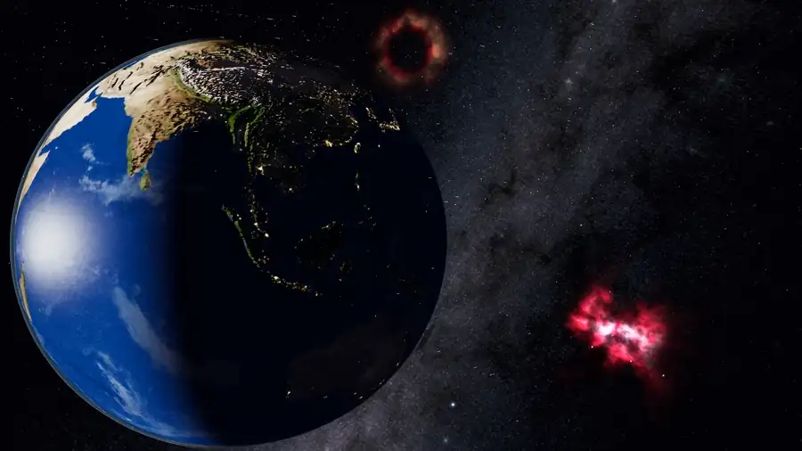
</p>

<p align="center">
  <sub>This README is one photon's journey. It leaves the Sun at the top of the page and reaches each world at its real light-time.</sub>
</p>

| Light-time | Stop | Section |
| :--- | :--- | :--- |
| `T+00:03:13` | Mercury | [Everything, all at once](#everything) |
| `T+00:06:01` | Venus | [A tour, in motion](#tour) |
| `T+00:08:19` | Earth | [What is real](#real) |
| `T+00:12:40` | Mars | [How it works](#how) |
| `T+00:43:16` | Jupiter | [Meet Vela](#vela) |
| `T+01:19:28` | Saturn | [The field report](#report) |
| `T+02:39:50` | Uranus | [Run it yourself](#run) |
| `T+04:10:25` | Neptune | [Inside the code](#code) |
| `T+27,000 years` | Sagittarius A* | [Credits, at the edge of the map](#credits) |

<br>

<a id="everything"></a>
<p align="center"></p>

<p align="center"></p>

| | |
| :--- | :--- |
| **Set to now** | Every planet, moon and small body is placed from NASA JPL orbital elements for the current moment, on the TDB time scale, and turned by the IAU's rotation models. Earth's day and night match the real ones. |
| **478 worlds** | The Sun, 8 planets, 22 major moons, 2 dwarf planets, 9 asteroids and 437 minor moons, every one in the Atlas. |
| **A real sky** | 12,596 Hipparcos stars at their true positions and colours, inside the Gaia all-sky Milky Way, aligned to the galactic frame. |
| **Down to the ground** | Keep scrolling and a planet becomes a web map, streaming the sharpest imagery NASA, JAXA, ESA and USGS publish: 9.5 m a pixel on Earth. |
| **Stand and look up** | Stand on any world and see its own sky, with every planet and moon where it really is: Saturn's rings arching overhead, Earth hanging over the Moon. |
| **Out to the galaxy** | Zoom out without a cut, past the nearest stars and through the galactic disk, to the black hole at the centre of the Milky Way. |
| **A guide with a voice** | Vela comments, explains, jokes and worries, in about an hour of her own recorded voice. |

<table>
  <tr>
    <td width="50%">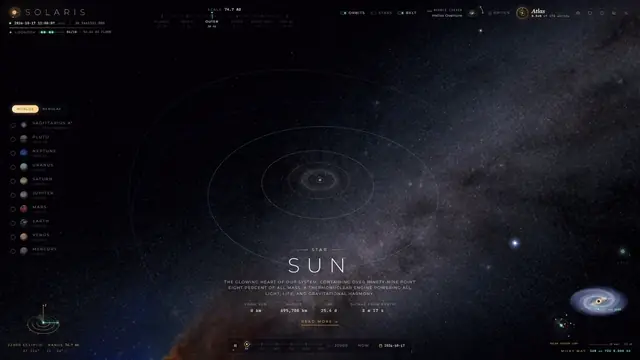</td>
    <td width="50%">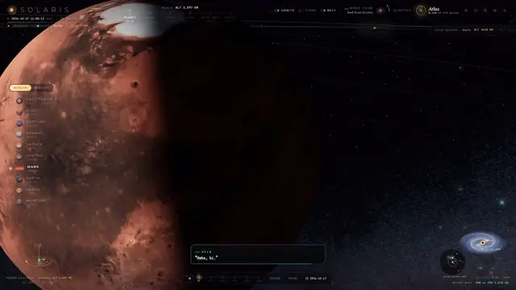</td>
  </tr>
  <tr>
    <td align="center"><sub>The overview, with every orbit from JPL's elements</sub></td>
    <td align="center"><sub>Vela, keeping you company at Mars</sub></td>
  </tr>
</table>

<br>

<a id="tour"></a>
<p align="center"></p>

Every clip below was captured from the running site, frame by frame. Positions, phases and sizes are true for the date on screen.

<table>
  <tr>
    <td width="50%">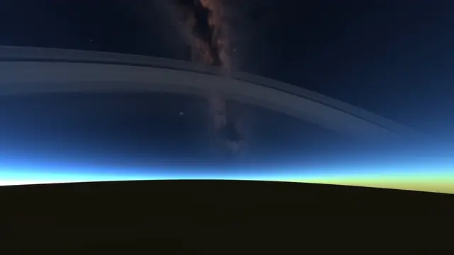</td>
    <td width="50%">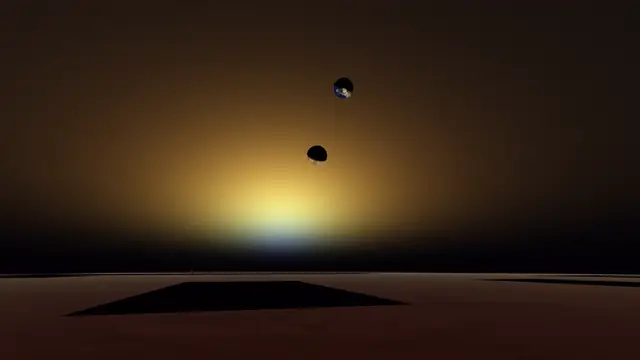</td>
  </tr>
  <tr>
    <td align="center"><sub><b>Sunset on Saturn's cloud tops.</b> The rings arch across the sky.</sub></td>
    <td align="center"><sub><b>Dusk at Meridiani Planum.</b> Mars's blue sunset, Phobos and Deimos overhead.</sub></td>
  </tr>
  <tr>
    <td width="50%">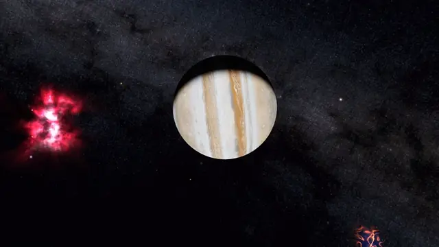</td>
    <td width="50%">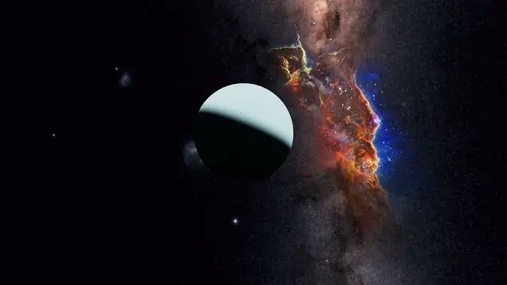</td>
  </tr>
  <tr>
    <td align="center"><sub><b>Jupiter from Io,</b> at its true angular size.</sub></td>
    <td align="center"><sub><b>Uranus from Miranda,</b> a crescent lit from where the Sun really is.</sub></td>
  </tr>
  <tr>
    <td width="50%">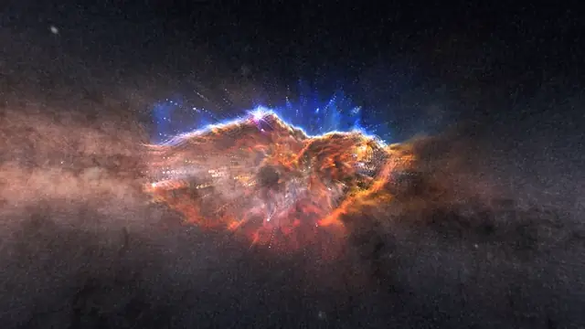</td>
    <td width="50%">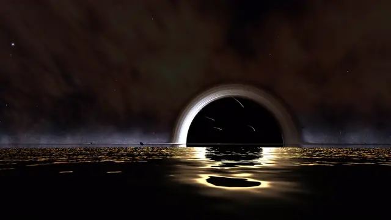</td>
  </tr>
  <tr>
    <td align="center"><sub><b>Into a photograph.</b> Webb's Cosmic Cliffs, split into seven depths you fly through.</sub></td>
    <td align="center"><sub><b>The shore of Sagittarius A*.</b> The sea is imagined; the bending of light is not.</sub></td>
  </tr>
</table>

<br>

<a id="real"></a>
<p align="center"></p>

Solaris is an explorer, not a navigation-grade ephemeris. A spacecraft needs metres; a visitor needs to see Jupiter in the right part of the sky. Each of these numbers is enforced by a test: if an edit moves the planets further than this, the build fails.

| Bodies | Elements | Checked accuracy |
| :--- | :--- | :--- |
| 8 planets | JPL secular-rate elements (Standish), valid 1800–2050 | under 0.25° against a VSOP87-based ephemeris in 2026 and 2040, typically under 0.05° |
| Earth's Moon | JPL mean elements, with 6.0-year apsidal and 18.6-year nodal precession | under 2° against JPL Horizons (0.7° on 2026-10-14) |
| 21 major moons | JPL Horizons osculating elements at 2026-10-14 TDB | exact at the epoch; Titan within 5° propagated back 26.8 years |
| Pluto, Ceres, 9 asteroids | JPL Small-Body Database osculating elements | two-body; degrades slowly away from each epoch |

For scale, the full Moon is about 0.5° across.

<details>
<summary><b>Time, orientation and the sky</b></summary>

- **Kepler solver:** Newton–Raphson on `M = E − e sin E` to a tolerance of 1e-12, with a high-eccentricity starter.
- **Time:** the clock runs in UTC; ephemerides use TDB ≈ UTC + 69.184 s. J2000.0 is 2000-01-01 11:58:55.816 UTC.
- **Orientation:** the planets, the Sun, Pluto, Ceres, Vesta, Eros, Gaspra and Ida use the IAU WGCCRE 2015 pole and prime meridian, so Earth's sub-solar point matches the real time of day and Saturn's rings were edge-on to Earth at the March 2025 ring-plane crossing (both unit-tested). Moons rotate synchronously.
- **Stars:** Hipparcos positions rotated from ICRF into the ecliptic frame: every star brighter than V 4.6 on the celestial sphere, plus 12,281 stars within 120 pc drawn in 3D when you zoom out. `npm run build:stars` regenerates the file from the full catalogue.
- **Milky Way:** built from the ESA/Gaia all-sky map, aligned with the galactic frame (north galactic pole RA 192.859°, Dec +27.128°), with 140,000 disk stars importance-sampled from a face-on galaxy map and lifted off the mid-plane with a sech² profile.
- **Main belt:** 3,200 instanced rocks with synthetic elements and Kirkwood gaps at the 3:1, 5:2, 7:3 and 2:1 resonances. They are statistical, not real asteroids.

</details>

<details>
<summary><b>Imagery, and saying what it is</b></summary>

| Body | Imagery | Endpoint | Finest |
| :--- | :--- | :--- | :--- |
| Earth | Sentinel-2 cloudless 2016 | EOX WMTS | ≈ 9.5 m/px |
| Moon | SELENE/Kaguya Terrain Camera mosaic | NASA Moon Trek WMTS | ≈ 21 m/px |
| Mars | MRO CTX global mosaic, tinted | Trek → Esri-hosted cache | ≈ 10 m/px |
| Mercury | MESSENGER MDIS BDR | NASA Mercury Trek WMTS | ≈ 234 m/px |
| Venus | Magellan SAR mosaic | USGS Astrogeology WMS | ≈ 290 m/px |
| The giants | Solar System Scope 2k maps | bundled | global only |

Tiles stream coarse to fine and nearest first, at most six at a time, chosen by screen-space error; requests the view no longer needs are cancelled, and a missing tile's nearest loaded ancestor stands in, so there are never holes. No server needs a key: every endpoint, its deepest level and its CORS headers were checked from GitHub Actions posing as the live site (`scripts/verify-tile-sources.mjs`, `docs/research/`).

The labels are honest. Venus says *radar*, not visible light. The Moon and Mercury say *monochrome*. The giant planets say *cloud tops*, because they have no ground at all.

</details>

<details>
<summary><b>Standing on other worlds</b></summary>

- **Sky:** a single-scattering Rayleigh and Mie atmosphere: Earth blue by day and red at sunset, Mars butterscotch with a blue glow around the setting Sun, Venus a dim orange overcast. The Moon and Mercury have black skies with stars by day.
- **What's up:** the Sun, planets and major moons from their real positions as seen from your spot, at true angular sizes, lit by the Sun so phases show, reddened near the horizon. Bodies too small for a disc are points of their real magnitude.
- **Telescope:** zoom the lens from 100° to 0.2° to see Jupiter's moons and Saturn's rings from Earth.
- **Time of day:** jump to the next local sunrise, noon, sunset or night on any body. A test checks Greenwich's 21 June sunrise to within 5 minutes.
- **Look up from…:** one click stands you on a moon with its planet about 40° up on the sunlit side: Earth from the Moon, Saturn from Enceladus, Mimas or Iapetus, Jupiter from Europa or Io, Mars from Phobos, Uranus from Miranda, Neptune from Triton, Pluto from Charon.

</details>

<br>

<a id="how"></a>
<p align="center"></p>

<p align="center"></p>

1. **Elements.** Each world starts as six numbers from NASA JPL: the size, shape and tilt of its orbit, and where it was at an epoch.
2. **Time.** Your clock is UTC, which jumps with leap seconds. Planets follow TDB, a smooth scale 69.184 s ahead. Solaris converts every frame and counts days from J2000.
3. **Position.** Kepler's equation has no algebraic solution, so Solaris guesses and corrects with Newton–Raphson until the error is below 10⁻¹²; for a near-circular orbit that takes two or three steps.
4. **Orientation.** The IAU's rotation models give each world's pole and the longitude facing you, so its day and night are the real ones.
5. **Precision.** A graphics card stores positions in 32-bit floats: near Neptune, neighbouring values are 512 km apart, and a moon would jitter. So every frame the whole universe is shifted so the camera sits at zero, and the distant stars absorb the error.
6. **Drawing.** three.js on WebGL2, with each zoom level on its own scale, so the readout always converts with the scale actually on screen.

<details>
<summary><b>Scales, the camera and the lens</b></summary>

| Tier | Render scale |
| :--- | :--- |
| Close-up of a body | that body's globe radius (km) |
| Solar System | `D = 50 + 65 · r^0.58` units for heliocentric distance r in AU |
| Local stars (< 120 pc) | 700 + 38 units per parsec, so the nearest stars sit beyond Pluto |
| Milky Way | 1,320 units per kpc; the Sun at R₀ = 8.277 kpc, 21 pc above the mid-plane |

- **Exploration** compresses distances and keeps true size ratios; **True Distances** is linear (1 unit = 1,000,000 km) with globes enlarged so they stay visible, and moons pushed out of their swollen parents with `scale · min(d, 4R) + max(0, d − 4R)`.
- **Observation camera:** altitude scales with √R from a reference shot over Earth, so NASA radii keep their order on screen; the planet sits in the left third of a wide 55° lens, so its limb curves the way a real lens curves it; the vantage is chosen so the Milky Way crosses behind the planet.
- **Lens profiles** (`L`): *Cinematic* (bloom, mild barrel distortion, chromatic aberration, grain, rotational motion blur), *Fisheye*, and *Clean* for inspection. Motion blur is off under `prefers-reduced-motion`.
- **Sagittarius A*** uses GRAVITY and EHT parameters for its readouts; the shader is an artistic ray-march with approximate light bending, not a general-relativistic ray tracer.

</details>

<br>

<a id="vela"></a>
<p align="center"></p>

<p align="center"></p>

Vela is Solaris's guide: a small glowing orb with a star on her antenna, drawn on a 23 × 21 pixel grid, with eight kinds of eyes, six mouths and five costumes. She has **572 lines**, about an hour of speech. She tells you a fact the first time you reach a world and a joke the second, notices when you speed up time or stare at Saturn for a while, keeps a memory of where you have been, and counts your exploration as a percentage. At 100% she says goodbye, and means it.

Her voice was made line by line: Chatterbox text-to-speech (its Turbo model performs tags like `[laugh]` and `[sniff]`), voice conversion onto one reference recording so every line shares her timbre, pauses trimmed to a breath, loudness levelled to −17 LUFS, and any take far too long or short for its words re-recorded with another seed.

<br>

<a id="report"></a>
<p align="center"></p>

<p align="center">
  <a href="https://solarises.vercel.app/report/">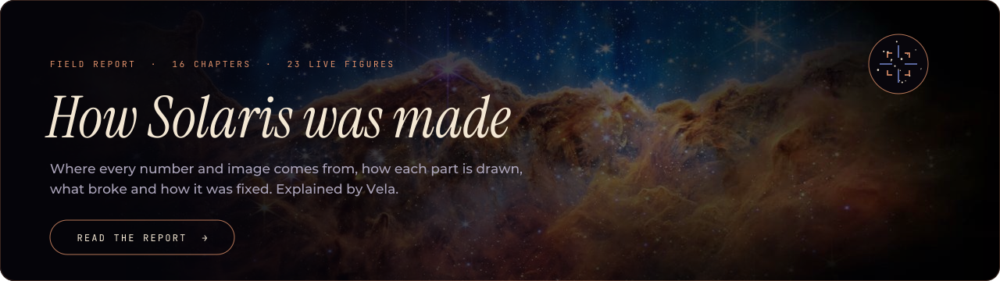</a>
</p>

Solaris comes with its own technical report, and the report is a website too. Its background is the live sky, from Solaris's own star data, and the telescope turns to a new target for every chapter. Its figures run: a 3D orrery on NASA's elements, the Earth and Moon from true size to 30×, Kepler's equation solving itself, real tiles streaming in from blurry to sharp. Vela explains every one of them.

It also documents **Light Travel**, the launch film, in which a photon leaves the Sun and a light-clock counts its journey to each world. Every frame of the film is the live site, captured on a virtual clock so the browser could take as long as it needed per frame. [Watch the film](https://solarises.vercel.app/report/#film).

<br>

<a id="run"></a>
<p align="center"></p>

You need Node.js 20 or newer.

```bash
git clone https://github.com/LetMeCodex/solaris.git
```

```bash
cd solaris && npm install
```

```bash
npm run dev
```

Then open http://localhost:5173/solaris/ for the explorer and http://localhost:5173/solaris/report/ for the report.

| Script | What it does |
| :--- | :--- |
| `npm test` | 142 Vitest tests in 23 files: the Kepler solver, ephemeris accuracy against JPL and VSOP87 references, IAU orientation, sky frames, the scale model, catalogue integrity, the texture cache, the camera rig and more |
| `npm run lint` | ESLint, with the TypeScript and React hooks rules |
| `npm run typecheck` | `tsc --noEmit` |
| `npm run build` | type-check, then a Vite build of the explorer and the report into `dist/` |
| `npm run build:stars` | regenerate `public/data/stars.json` from the full Hipparcos catalogue |

**Deploying.** The live site is on Vercel, which builds `main` as it is pushed. `.github/workflows/deploy.yml` also runs lint, tests and the build on every push and pull request, and publishes to GitHub Pages under `/solaris/`.

<details>
<summary><b>Controls</b></summary>

| Key or gesture | Action |
| :--- | :--- |
| `Space` | Pause / play |
| `/` | Open the Atlas |
| `P` | Take a picture |
| `H` | Hide / show the interface |
| `O` · `C` · `B` | Orbits · constellation figures · asteroid belt |
| `L` | Cycle the lens: Cinematic, Fisheye, Clean |
| `Esc` | Close drawers, back to the overview |
| Drag · wheel | Orbit · approach |
| Arrow keys or right-drag | Free look; double-click to return to the composed shot |
| Wheel or pinch near a body | Zoom towards the cursor, down to the imagery's limit |
| Drag near a body | Grab and move the ground |
| Explorer panel | Landmarks, search, Real sunlight, Stand here · look up |

</details>

<br>

<a id="code"></a>
<p align="center"></p>

```text
src/
├── astronomy/     Kepler solver, coordinate frames, IAU rotation models          904 lines
├── data/          the catalogue: 479 bodies, orbits, physical constants        2,103 lines
├── rendering/     planets, rings, sky, galaxy, black hole, lenses, shaders    10,652 lines
├── explorer/      streaming surface tiles, landmarks, standing on the ground   3,093 lines
├── navigation/    the camera rig, observation framing, scale tiers              1,635 lines
├── ui/            the HUD: Atlas, Gallery, settings, the tour, the eyepiece    6,480 lines
├── companion/     Vela: her lines, her memory, when to speak                      296 lines
├── audio/         the soundtrack and effects                                       303 lines
├── simulation/    the clock                                                        121 lines
├── report/        the field report, its figures, and Vela in pixels           3,702 lines
└── tests/         142 tests in 23 files
```

Everything is TypeScript. Heavy assets load only when they are needed, and the report is its own Vite entry, so the explorer never downloads it.

The artwork in this README is generated too: `python scripts/readme/build_readme_art.py` draws every word as vector paths from open-licence fonts, wraps the planets in the site's own surface maps, and writes the animated SVGs into `docs/readme/`.

<br>

<a id="credits"></a>
<p align="center"></p>

Solaris stands on public science. Orbital elements come from **NASA JPL** (public domain) and rotation models from the **IAU WGCCRE**. The stars are **ESA Hipparcos** (CC BY-NC 3.0 IGO) and the sky map is **ESA/Gaia/DPAC** (CC BY-SA 3.0 IGO). The nebula photographs are from **NASA, ESA, CSA and STScI** (Webb and Hubble) and **ESO** (VISTA); the face-on galaxy is by **NASA/JPL-Caltech/ESO/R. Hurt** (CC BY 4.0); planet textures are from **Solar System Scope** (CC BY 4.0). Surface imagery streams from **EOX**, **NASA Trek**, **Esri** and **USGS Astrogeology**. The README's lettering is set in **Montserrat**, **Instrument Serif**, **JetBrains Mono** and **VT323** (SIL Open Font Licence).

Every source, its licence and the attribution it asks for is listed in [ASSETS.md](./ASSETS.md), and in the report's references.

**Licence.** The code is [MIT](./LICENSE). Third-party data, imagery and textures keep their own licences.

<br>

<p align="center">
  <sub>The photon that left the Sun at the top of this page is still travelling. It will reach the galactic centre in about 27,000 years.<br>Solaris will be there when it does.</sub>
</p>
